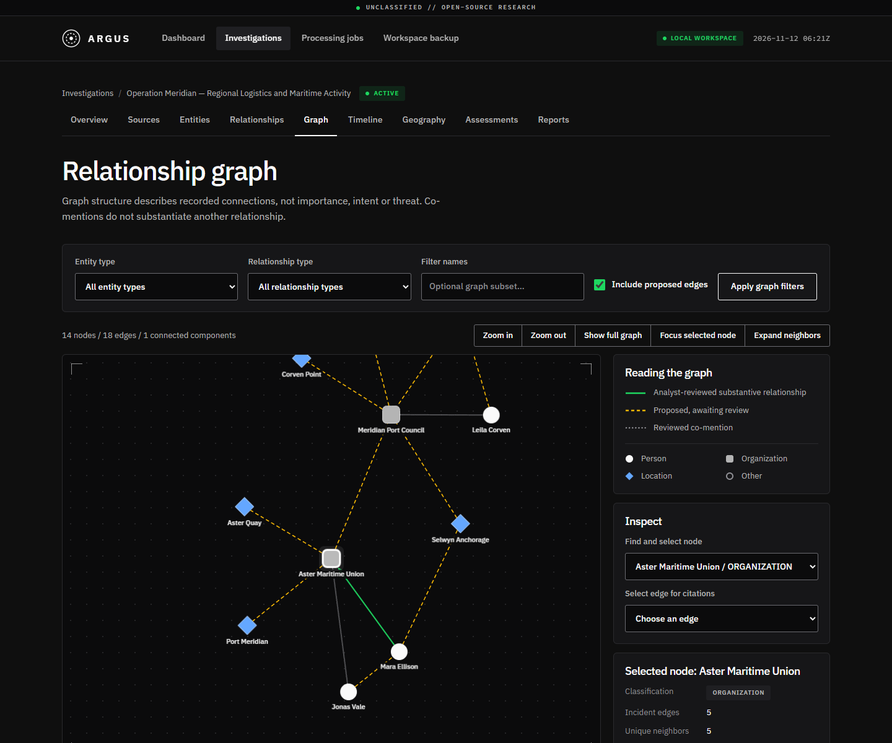
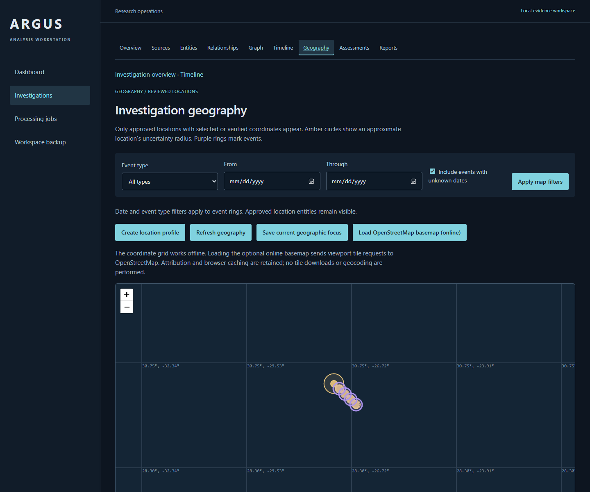

# ARGUS

A local-first OSINT analysis workstation for preserving source documents, reviewing
machine proposals and producing traceable analytical assessments. Evidence stays on
your machine. Source observations, analyst interpretation and unresolved contradictions
remain distinct throughout the workflow.

Collect documents -> review entities -> explore connections -> reconstruct events ->
assess evidence -> export a report -> back up the workspace.

## Example investigation

**Operation Meridian — Regional Logistics and Maritime Activity** is a fully fictional
training exercise: 12 documents, three organizations, six people, five places, ten
dated events, fifteen proposed relationships, three reviewed relationships and five
claims. Two conflicting reports remain explicitly unresolved. All names, activities
and hypothetical open-water map points are fabricated.

| Reviewed graph | Geographic context |
| --- | --- |
| [](docs/screenshots/meridian-graph.png) | [](docs/screenshots/meridian-map.png) |

More actual application captures: [overview](docs/screenshots/meridian-overview.png),
[timeline](docs/screenshots/meridian-timeline.png), [assessments](docs/screenshots/meridian-assessments.png),
[report](docs/screenshots/meridian-report.png).

With the services running, load the exercise through the real import/NLP/review APIs:

```powershell
intelligence-service/.venv/Scripts/python.exe scripts/load_demo.py
```

Every run creates a new investigation and records its IDs in ignored
`.local/meridian-result.json`. The loader never changes existing investigations or
writes directly to SQLite. Follow the [complete demonstration walkthrough](docs/demo-walkthrough.md)
for entity merge, graph/timeline/map exploration, contradictory claims, reporting and recovery.

## What works

- Investigations with scope, archive/search and confirmed deletion restrictions.
- Preserved text/PDF/pasted sources, original hashes, metadata, manual reliability,
  extraction limits and byte-identical downloads.
- Local English entity recognition with persistent jobs, bounded retries, cancellation,
  recovery and proposed/approved/rejected review. Corrections/merges retain provenance.
  Bulk approval previews all matching pages, with optional grouping of identical names/types.
- Exact snapshot citations and deterministic co-mention proposals; reviewed relationships,
  graph filters, metrics, neighbor exploration and shortest paths.
- Manual/generated events with exact/month/year/unknown dates and chronological filters.
  Relative or ambiguous expressions remain unresolved rather than receiving invented dates.
- Approved geographic profiles with explicit/verified coordinates and uncertainty radii.
  Leaflet works offline with a coordinate grid; online OSM tiles require an explicit choice.
- Evidence-backed claims with supporting/contradictory/context passages, manual confidence,
  reasoning, conflict tracking and explicit review.
- Approved-only Markdown reports with ten sections, validated references/original hashes,
  immutable history and attachment downloads.
- Consistent workspace backup, checksum manifest and validated restore into a new directory.

Confidence and reliability are analyst judgments, not computed truth probabilities.
Approval records review, not independent verification. Structural associations alone
never demonstrate wrongdoing, intent or threat.

## Run locally

Verified on **Windows x64**, **.NET SDK 10.0.102 / runtime 10.0.2**, **Python 3.14.6**
and installed Microsoft Edge. The project requires .NET 10 and Python 3.12+; global.json
pins the SDK and requirements-lock.txt reproduces the tested Python/model environment.
No Docker, paid API, hosted LLM, Node runtime or runtime model download is required.
Initial installation needs internet; normal local analysis works offline.

From the repository root in PowerShell:

```powershell
dotnet tool restore
dotnet restore Argus.sln
python -m venv intelligence-service/.venv
intelligence-service/.venv/Scripts/python.exe -m pip install -r intelligence-service/requirements-lock.txt
dotnet build Argus.sln -c Release --no-restore
```

Start these in three terminals:

```powershell
# Local NLP
intelligence-service/.venv/Scripts/python.exe -m uvicorn app.main:app --app-dir intelligence-service --host 127.0.0.1 --port 8000
```

```powershell
# API and local evidence storage
$env:ARGUS_DATA_DIRECTORY = "$PWD/.local/workspace"
dotnet run --project src/Argus.Api -c Release --no-build --launch-profile http
```

```powershell
# Browser application
dotnet run --project src/Argus.Web -c Release --no-build --launch-profile http
```

Open **http://localhost:5200**. API: **http://localhost:5100**. NLP: **http://localhost:8000**.
API health `/health`; API contract `/openapi/v1.json`; NLP documentation `/docs`.
Startup applies committed migrations. Stop existing processes before rebuilding their
configuration; run one API/worker per data directory. See [setup and troubleshooting](docs/setup.md).

The example data directory is Git-ignored. Without an override, `dotnet run` uses
`src/Argus.Api/data`. Keep the database and documents together. `.env.example` documents
configuration; .NET does not automatically load it. Keep services bound to loopback:
ARGUS is single-user and has no authentication or public-hosting hardening.

## Verify and recover

```powershell
# Build, unit/integration/Python suites, formatting and lint
powershell -NoProfile -ExecutionPolicy Bypass -File scripts/verify.ps1

# Also run seven isolated live workflows, including Edge and backup/restore
powershell -NoProfile -ExecutionPolicy Bypass -File scripts/verify.ps1 -Full
```

Smokes use temporary databases/ports, stop their own services and leave diagnostic logs
under ignored `.local`. Installed Edge is used without a browser download. The Meridian
smoke regenerates the fictional screenshots above. Migration/audit and fresh-source
verification commands are documented in [setup.md](docs/setup.md).

Phase 7 verification (2026-11-12): **222 tests passed** (164 .NET, 58 Python),
Release build with zero warnings/errors, all six live workflows passed, and source-only
setup with a fresh locked Python environment passed. Full results and remaining limits
are in the [development plan](docs/development-plan.md#phase-7-final-verification).

Use **Workspace backup** to download a consistent database/originals archive. Restore
into a new directory using the built API executable:

```powershell
dotnet src/Argus.Api/bin/Release/net10.0/Argus.Api.dll --restore-backup "C:/Backups/argus-backup.zip" "C:/Argus/restored-data"
```

Then start the API with `ARGUS_DATA_DIRECTORY` pointing to that directory. Restore never
overwrites an existing workspace. Archives contain research data, are not encrypted or
signed, and should be restored only from a trusted origin. See [recovery contracts](docs/quality-contracts.md).

## Architecture and limits

Blazor Web -> versioned .NET API -> Core domain rules / EF Core SQLite / managed originals.
The API worker calls a separate stateless FastAPI/spaCy service over bounded local HTTP.
Web never opens SQLite; Python never writes the database. Cytoscape 3.33.4 and Leaflet
1.9.4 are vendored with licenses/integrity metadata; no runtime CDN is needed.

English NER is imperfect and every finding needs review. There is no OCR or automatic
geocoding. The offline map is a coordinate grid, not cached geographic imagery. Reports
are Markdown snapshots of approval at generation time; later corrections need a new
report. Soft-removed findings remain in audit/storage without a restore UI. Export,
graph and NLP bounds are explicit; oversized work fails rather than truncating evidence.
A hard crash can leave temporary/orphan files. One upstream Python test-client
deprecation warning remains. Broader operating-system/browser coverage is unverified.

Documentation: [specification](docs/project_specifications.md) ->
[architecture](docs/architecture.md) -> [schema](docs/database-schema.md) ->
[API contracts](docs/api-contracts.md) -> [NLP](docs/nlp-contracts.md) ->
[graphs](docs/graph-contracts.md) -> [temporal/geographic](docs/temporal-contracts.md) ->
[assessments/reports](docs/assessment-contracts.md) -> [quality/recovery](docs/quality-contracts.md) ->
[development plan and verification record](docs/development-plan.md).
